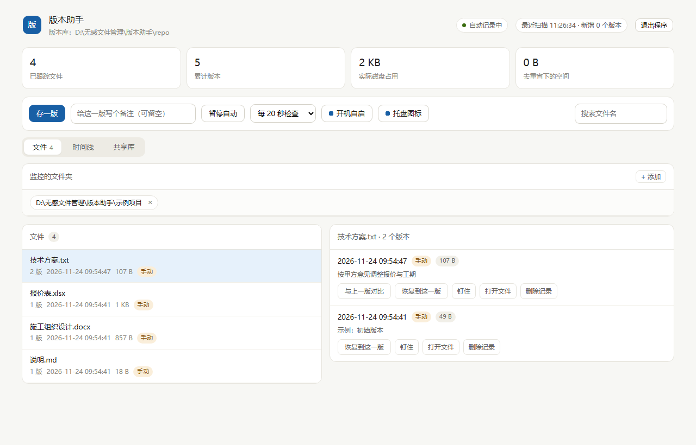
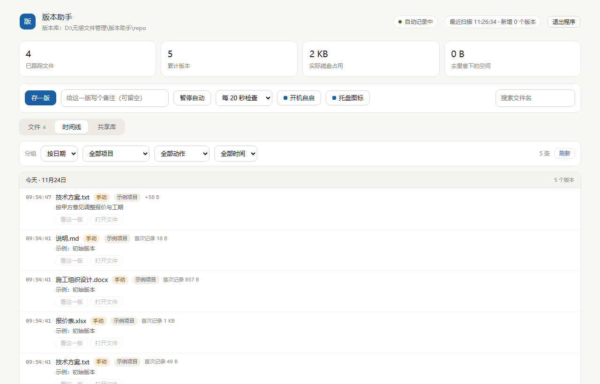

# 版本助手 · VersionKeeper

一个只做一件事的本地文件版本管理器：**盯着你的文件夹，把每次改动悄悄存下来，需要时一条时间线翻回去。**

为 Windows 桌面设计，纯 Python 标准库实现，**零第三方依赖**，不需要装数据库、不需要装运行时服务、不需要联网。



---

## 它解决什么问题

大多数人的"版本管理"其实是文件名后缀：

```
投标文件.docx
投标文件_改.docx
投标文件_改2.docx
投标文件_最终.docx
投标文件_最终_真的最终.docx
```

这套办法有三个绕不过去的坑：

1. **靠记性**——忘了另存，改完直接关掉，上一稿就再也回不来。
2. **找不着**——想找"上周三报价还没改的那版"，只能挨个点开。
3. **分不清**——改了哪几个字？打开两个窗口肉眼比对。

版本助手把这三点变成：自动存、按文件看时间线、一键看差异。

## 特性

- **自动 + 手动两种存版方式**
  后台按间隔（10 秒 ~ 5 分钟）静默检查，只记录真正变过的文件；也可以在关键节点手动"存一版"并写备注。
- **内容寻址去重**
  每个版本按 SHA-256 索引，内容相同只落一份盘。10 个版本不等于 10 份空间。
- **按文件的版本时间线**
  不是"整个文件夹打包成快照"，而是每个文件有自己独立的历史，找某一版不用翻整包。
- **全局时间线**
  跨所有文件、按日期分组，可按项目 / 动作 / 时间筛选，一眼看清今天动了哪些东西。
- **格式感知的差异对比**
  Word 逐段、Excel 逐单元格、文本逐行，红绿标出增删，自动合并上下文。
- **回退不丢东西**
  恢复旧版之前，先把当前内容自动存成一版。回退永远可逆。
- **误改防护**
  自动跳过 `~$xxx.docx` 这类 Office 临时文件，跳过 2 秒内还在写入的文件，不会存出一堆垃圾版本。
- **保留策略分级**
  自动版每文件默认保留最近 30 个；手动版和钉住的版本永不被自动清理。
- **托盘常驻 + 开机自启**
  纯 Win32 `Shell_NotifyIcon` 实现，不引入 pystray / Pillow；自启写 `HKCU\...\Run`，无需管理员权限，开机不弹黑框。
- **可多人共用**
  版本库可放到共享盘：并发写入安全、作者自动归属、同一修改不会被两台机器重复记录。



## 快速开始

**要求**：Windows 7 以上，Python 3.9+（Python 3.12 实测）。

```bash
git clone https://github.com/longking88/version-keeper.git
cd version-keeper
```

然后双击 **`启动.bat`**。它会自动找到 Python、后台启动服务、打开浏览器界面：

```
http://127.0.0.1:8848
```

托盘出现后就可以关掉浏览器了，程序继续在后台记录。

首次使用三步：

1. 在「监控的文件夹」点 **+ 添加**，选你要看着的目录（可以加多个）。
2. 选个检查间隔，默认 20 秒够用。
3. 干你的活。改完保存，几秒后版本就自己进去了。

## 命令行

```bash
python server.py                                  # 默认库 ./repo，界面 8848
python server.py --repo D:/备份/版本库             # 指定版本库位置
python server.py --root D:/项目/南东路投标 --tray   # 指定监控目录并常驻托盘
python server.py --port 8850 --no-browser          # 换端口、不自动开浏览器
python server.py --once "投标截止前定稿"           # 只存一版然后退出（可配计划任务）
```

## 三个视图

| 视图 | 用途 |
|---|---|
| **文件** | 左侧按最近修改排序的文件列表（可搜索），右侧是选中文件的专属版本时间线 |
| **时间线** | 跨所有文件的全局流水，按日期分组，可筛选项目 / 动作 / 时间范围 |
| **共享库** | 查看当前版本库位置、切换本地库与共享盘、看有哪些机器在用同一个库 |

## 差异对比能力

| 格式 | 对比粒度 | 说明 |
|---|---|---|
| `.txt` `.md` `.csv` `.json` `.xml` `.html` | 逐行 | 自动合并上下文，隐藏无关段落 |
| `.docx` | 逐段 | 解压后读 `document.xml`，按段落抽文本比对 |
| `.xlsx` | 逐单元格 | 读 `sharedStrings.xml` + 各 sheet，按 `A1` 定位 |
| `.pdf` | 文件级 | 只比大小与哈希（页级对比需引入第三方库，暂未做） |
| 其他二进制 | 文件级 | 比大小与哈希 |

## 工作原理

```
文件改动
   │
   ├─ 计算 SHA-256 ──► 已存在？──是──► 只增加一条版本索引
   │                        │
   │                        否
   │                        ▼
   │                  zlib 压缩（压缩率 >8% 才压）落盘到 objects/
   │
   └─► 写入 SQLite 索引：这个文件、这个时间、这个哈希、谁存的、什么方式
```

**数据表**（SQLite，WAL 模式，支持并发读写）：

| 表 | 作用 |
|---|---|
| `items` | 受管理的文件，路径 + 扩展名 + 首次/最近见到时间 |
| `versions` | 版本记录：所属文件、时间、哈希、大小、来源（手动/自动）、备注、作者、是否钉住 |
| `blobs` | 内容块索引：哈希 → 存储位置、原始大小、压缩方式 |
| `settings` | 全局设置 |
| `peers` | 用同一个库的机器与作者 |

**对象存储**是扁平的两级目录（`objects/ab/cdef...`），文件名即哈希。内容相同的文件、同一文件未改动的部分，天然共享同一份存储。

**并发安全**：多台机器写同一个共享库时，靠 SQLite 的 WAL + 20 秒锁等待 + 插入冲突重试解决竞争；自动记录的重复抑制用"内容哈希与上一条相同且间隔小于 120 秒就跳过"来判断，避免两台机器同时扫到同一次修改而记成两条。

## 目录结构

```
版本助手/
├─ core.py            # 版本引擎：哈希、去重、索引、差异算法
├─ server.py          # 本地服务 + 后台扫描线程（http://127.0.0.1:8848）
├─ tray.py            # 托盘图标（纯 Win32 API，含程序化生成的图标）
├─ autostart.py       # 开机自启（注册表 HKCU\...\Run）
├─ ui/index.html      # 单页界面，三个视图
├─ assets/tray.ico    # 托盘图标（16/32/48 三尺寸）
├─ 启动.bat            # 双击入口：找 Python → 后台启动 → 开浏览器
├─ 使用说明.md         # 面向使用者的详细手册
└─ 运行时生成：
   ├─ repo/           # 版本库（objects/ 内容块 + index.db 索引）
   ├─ repo.txt        # 版本库位置指针
   ├─ identity.json   # 本机作者名
   └─ logs/           # 日志（无控制台启动时）
```

## 已知限制

- **改名/移动文件会断链**。程序按路径识别文件，重命名后会被当成新文件，历史从零开始。（后续可基于 NTFS 文件 ID 追踪解决。）
- **PDF 只做文件级对比**，没有页级差异。
- **只有一个实例**。默认端口 8848，重复启动会直接打开已在运行的那份界面。
- **共享库依赖文件锁**。SMB 网络盘上 SQLite 的锁行为取决于服务端实现，高并发场景建议仅少数人同时写入。
- **不加密**。版本库内容未加密，敏感文件请放在受控磁盘上。

## 授权

未指定 License。如需开源分发，建议补充 MIT 或 Apache-2.0。
